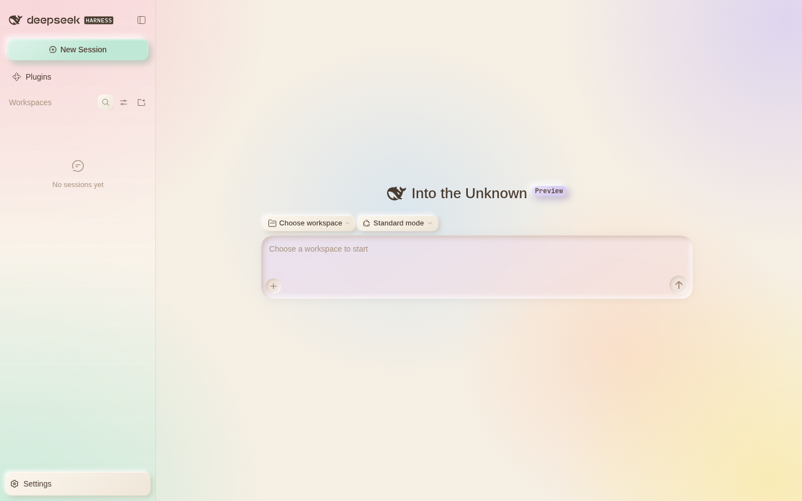
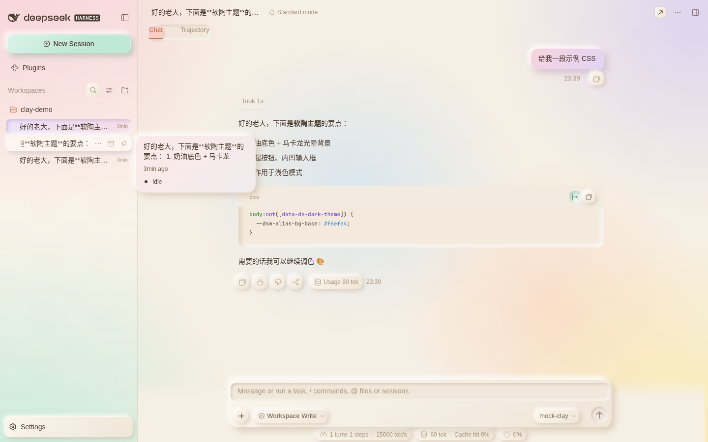
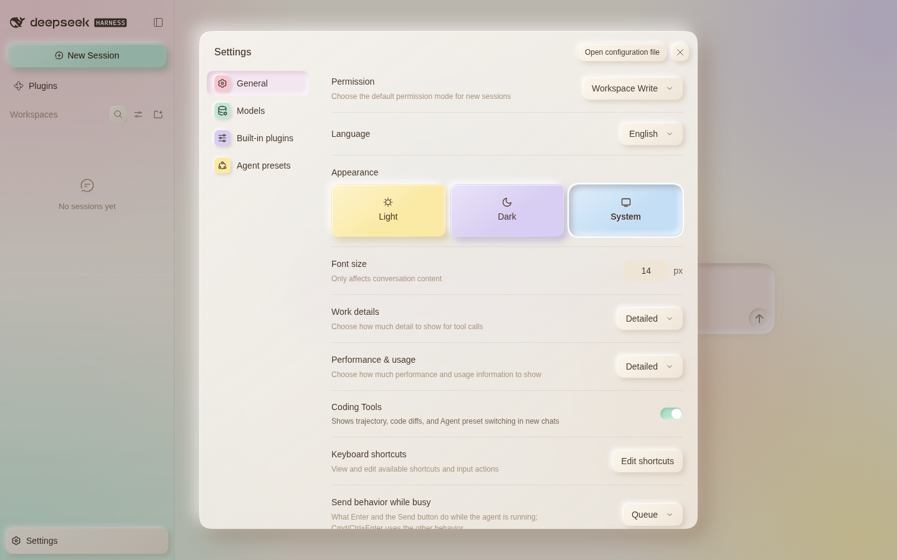
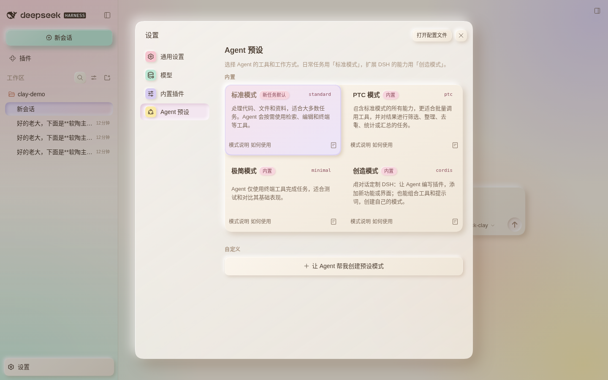
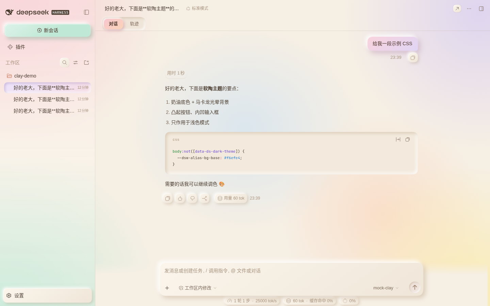
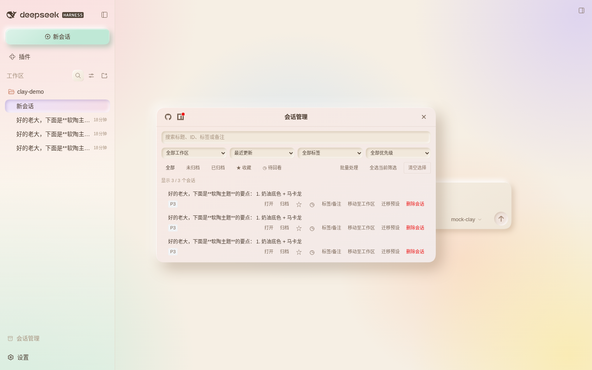
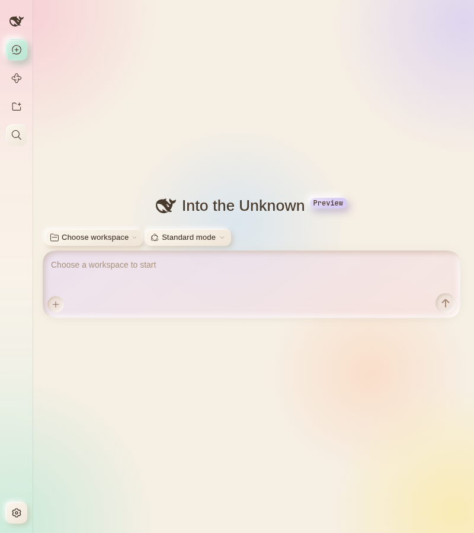

# dsh-clay-theme · 马卡龙软陶主题

给 [DeepSeek Harness](https://github.com/deepseek-ai/deepseek-harness)（DSH Desktop / DSH NEXT / `dsh --profile web`）用的**马卡龙软陶（Clay / Neumorphism）主题**插件。

- 奶油底色 + 粉 / 薄荷 / 薰衣草 / 柠檬 / 天空 / 蜜桃 六色马卡龙光晕背景
- 凸起按钮、内凹输入框，阴影随马卡龙色调变化
- 14–24px 圆角、胶囊分段切换、粉桃渐变主按钮、马卡龙色设置图标
- **浅色 + 深色双模式**：浅色为奶油马卡龙，深色为黑巧克力底 + 酒红角落光晕，随 DSH 外观自动切换
- 纯 CSS 注入，不改 DSH 安装目录，可随时停用 / 卸载

## 截图

| 对话 | 会话 |
|---|---|
|  |  |
|  |  |
|  |  |

窄窗口：

## 安装

> 安装前先**关闭 DSH**，并备份 `~/.dsh/profiles/desktop/package.json` 和 `pnpm-lock.yaml`。
> Windows 下 `~` 即 `C:\Users\<你>\`；网页版 profile 为 `~/.dsh/profiles/web`。

1. 获取安装包（二选一）：
   - 从 [Releases](https://github.com/Tongnianbutongyang/dsh-clay-theme/releases) 下载 `dsh-clay-theme-<版本>.tgz`；
   - 或克隆本仓库后执行 `npm pack` 自己打包。
2. 把 tgz 放到一个固定位置，例如 `~/.dsh/plugins-local/dsh-clay-theme/`。
3. 编辑 `~/.dsh/profiles/desktop/package.json`：
   ```jsonc
   {
     "dependencies": {
       // ...原有依赖保持不变
       "dsh-clay-theme": "file:C:/Users/<你>/.dsh/plugins-local/dsh-clay-theme/dsh-clay-theme-0.1.10.tgz"
     },
     "dsh": {
       "profile": {
         "bundles": [
           // ...原有条目保持不变
           "dsh-clay-theme"
         ]
       }
     }
   }
   ```
4. 在该 profile 目录执行：
   ```bash
   pnpm install --ignore-scripts
   ```
5. 打开 DSH，在「设置 → 通用 → 外观」选择浅色或深色（或跟随系统），主题会自动切换。

> 也可以直接用 Git 依赖：`"dsh-clay-theme": "github:Tongnianbutongyang/dsh-clay-theme#v0.1.18"`。
> 本包目前**未发布到 npm**；若日后发布，可直接写 `"dsh-clay-theme": "^0.1.18"`。

## 回退 / 卸载

1. 关闭 DSH；
2. 恢复备份的 `package.json` 与 `pnpm-lock.yaml`（或手动删掉上面加的依赖行和 `bundles` 里的 `"dsh-clay-theme"`）；
3. 在 profile 目录重新执行 `pnpm install --ignore-scripts`。

临时停用：在 DSH 插件管理里关闭 `dsh-clay-theme` 即可。

## 工作原理

- `lib/client.js`：浏览器侧入口，经 `window.__ModuleLoader__.load()` 注册（**必须是经典脚本，不能写 `export`**，否则 DSH 会进入恢复模式），挂载时往 `<head>` 注入一份 `<style data-plugin-css="dsh-clay-theme/clay">`，卸载时移除。
- `clay.css`：主题本体，浅色规则限定在 `body:not([data-ds-dark-theme])` 下，深色规则限定在 `body[data-ds-dark-theme]` 下；主要覆盖官方 `--dsw-*` 设计 token，再补充少量组件样式。
- `lib/index.js`：Host 侧空插件；`cordis.patch.yml` 把插件挂进配置树。

## 已知限制

- 部分规则依赖 DSH 当前构建生成的 CSS Module 类名（如 `wSkVaW_root`、`sessionRow`、`_bubble`），DSH 升级后个别区域可能失效，需要更新本主题。
- 布局层（侧栏 / 主框架）刻意不使用 `backdrop-filter`，避免把第三方插件的 `position: fixed` 弹窗困在侧栏里（已验证兼容 `dsh-session-manager` 0.6.3）。
- 在 DSH 0.2.0-rc.1（DSH NEXT 2.0.16 / 网页版）上测试。

## License

MIT
